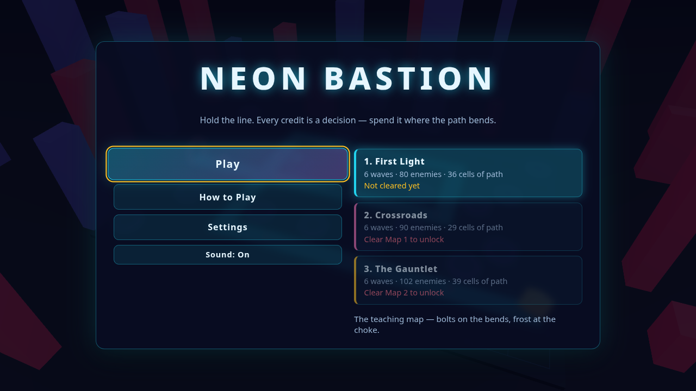
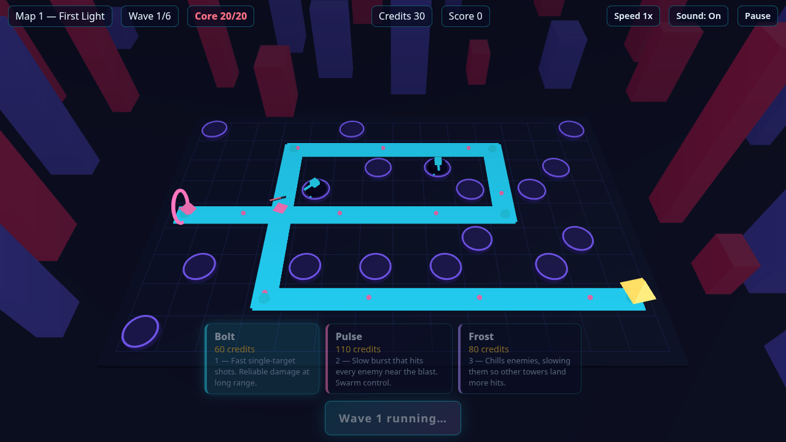

# Neon Bastion

A 3D neon tower defense built with [Three.js](https://threejs.org/) 0.160.0 — enemies stream along glowing paths toward your core; place towers on grid pads, upgrade and sell them, and manage a tight credit economy to hold the line through escalating hand-crafted waves.

**Play it live:** https://namdev-muse.github.io/neon-bastion/




## How to play

- **Enemies** follow the glowing path to your core. A leak costs core lives — at zero, the map is lost.
- **Click a pad** to place the selected tower. **1 / 2 / 3** pick Bolt, Pulse or Frost. Click a tower to select it, then **U** upgrades it and **X** sells it back for 70% of what you put in.
- **Bolt** fires fast single shots at long range. **Pulse** bursts and hits every enemy near the blast — the swarm answer. **Frost** chills enemies so your other towers land more hits.
- Kills pay **credits**; clearing a wave pays a bonus. Every credit is a decision: a tower now, or save for a stronger one later.
- **Space** starts the next wave when you're ready. There is no timer — build at your own pace, then commit.
- **Runners** are fast and fragile. **Armored** enemies shrug off bursts — focus them with bolts. **Bosses** cost five core lives if they leak.
- Clear a map to unlock the next one. Your best score is saved per map.

## Controls

| Input | Action |
|---|---|
| Click / tap | Select pad or tower |
| 1 / 2 / 3 | Pick Bolt / Pulse / Frost |
| U / X | Upgrade / sell selected tower |
| Space | Start next wave |
| F | Toggle 1x / 2x speed |
| P | Pause |
| M | Mute |
| R | Restart map |
| Esc | Back / deselect |

## Maps (M2 — 8 of 8)

| Map | Identity |
|---|---|
| 1. First Light | The teaching map — an S-bend with choke points at the turns. |
| 2. Crossroads | A short path that doubles back on itself; the middle zigzag is the whole map. |
| 3. The Gauntlet | Four turns, one long road, two bosses in the final waves. |
| 4. Switchback | Five sharp turns — bolts on the bends, frost in the middle. |
| 5. The Corridor | Two long parallel runs with a jog — the middle pads cover both. |
| 6. The Circuit | A full loop around the rim — inside pads see every side. |
| 7. Serpent | The longest road — every row is a firing line. The campaign breather: a good build feels unstoppable here. |
| 8. The Crucible | A winding maze, short on mercy — the final test, with four bosses in the last wave. |

## Development

No build step — static files served by GitHub Pages from `main`.

```bash
npm test          # smoke tests + bot harness (Node)
npm run render-check   # headless Chromium render check (Playwright)
npm run screenshots    # menu + gameplay shots at 3 resolutions
npm run serve     # serve locally on http://localhost:8126
```

- `physics.js` — pure simulation core (no DOM, no Three.js): grid, paths, towers, enemies, waves, economy, bots. Fully deterministic.
- `game.js` — Three.js rendering, menu/HUD, audio, game feel, public hooks (`window.__bastion`).
- `tests/smoke.js` — 214 Node checks over the simulation.
- `tests/bot.js` — anti-slop gates: a decision bot must clear every map; a random-placement bot must lose on every map; bolt-only spam must fail every map.
- `tests/render-check.js` — headless Chromium: menu, gates, screen-space pad clicks, keys, combat feedback, autopilot clear, leak, pause, `?map=` seed path, accessibility, FPS guard — zero console errors.

## Anti-slop

No auto-place, no "best tower" hint, no placement preview that solves the map. The maps are tuned so random placement loses and one-tower-type spam fails — the bot harness enforces both on every run.

## Version

v0.2.0 (M2 map craft — 8 maps). Three.js 0.160.0 via jsdelivr import map.

## License

MIT — see [LICENSE](LICENSE).
